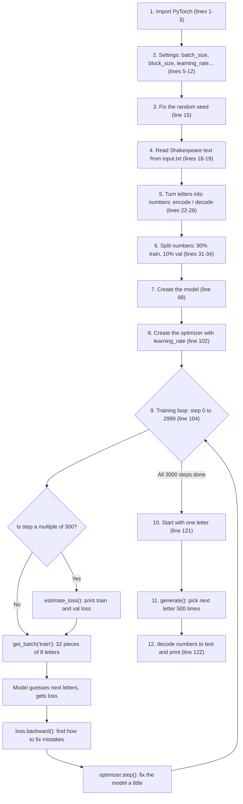

# miniGpt

A tiny character-level language model, trained on Shakespeare, that learns to write text one letter at a time. It follows Andrej Karpathy's "Let's build GPT" video, starting with the simplest model: a bigram model.

## How `bigram.py` works



## The 4 big parts

| Part | Lines | What it does |
|---|---|---|
| **1. Setup** | 1–15 | Imports the tools, chooses the settings and fixes the random seed |
| **2. Prepare data** | 17–44 | Reads the text, turns letters into numbers and picks random practice pieces |
| **3. Train** | 98–118 | 3000 times: guess, measure how wrong, fix a little. Checks progress every 300 steps |
| **4. Write** | 121–122 | The trained model writes 500 new characters of "Shakespeare" |

## One training step

These lines repeat 3000 times. This is where the learning happens:

1. **Get questions:** `xb, yb = get_batch('train')`
2. **Guess:** `logits, loss = model(xb, yb)`
3. **Find mistakes:** `loss.backward()`
4. **Fix a little:** `optimizer.step()`

(`optimizer.zero_grad()` clears the old fixes before working out new ones.)

## Key terms

| Term | Simple meaning |
|---|---|
| **Tensor** | A grid of numbers (1D list, 2D table, and so on) |
| **Loss** | How wrong the model's guesses are. Lower is better |
| **learning_rate** | How much the model changes itself after each mistake |
| **eval_interval** | How often to check progress (every 300 steps) |
| **eval_iters** | How many batches to average during each check (200) |
| **Seed** | Makes the "random" numbers the same on every run |
| **forward** | The model looks at letters and guesses the next one |
| **Bigram model** | A 65 × 65 table: for each letter, how likely each next letter is |

## Run it

```bash
pip install torch
python bigram.py
```
